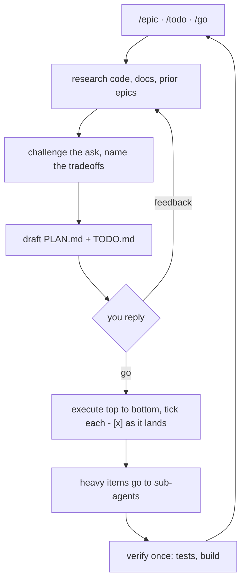

# ⚡ awesome-agent

> Plan-first agentic coding you can supervise: **research → plan → `go` → execute → track**, written to `PLAN.md` + `TODO.md` in your repo.

[](https://github.com/assawalhy/awesome-agent/actions/workflows/ci.yml)

Agentic coding commits to a direction before you can see it, then loses the
thread. awesome-agent fixes the loop: one agent plans and executes, a hard gate
holds it until you reply `go`, and every decision lands in markdown you can
review in the PR.

## 🧯 What goes wrong

| What goes wrong | What this does about it |
| --- | --- |
| You come back after an hour and can't tell which agent is doing what | One folder per goal: `.agents/plans/<NN>-<slug>/` with a `PLAN.md` and a `TODO.md`, so every piece of work has an address you can look up |
| Progress lives in a transcript that scrolled away | `- [x]` is written the instant an item lands, so the checklist is the progress bar, not a memory test |
| Picking work back up means re-explaining everything | Tell the agent to continue: it reads the active plan and `TODO.md` and picks up from there |
| A second agent can't be handed the work | The plan is on disk, not in someone's head, so any session, any harness, any model resumes from the same files |
| "Why did we do it this way?" is answered by vibes | `PLAN.md` keeps Goal, Approach, Decisions (with the alternative that lost), Milestones and Risks, committed with the code |
| The agent sometimes skips straight to writing code | A hard gate: no non-trivial execution before you reply `go` |
| Switching a harness's plan agent to its build agent is a fight, and the context dies | One agent, one context. The skill owns the gate; the harness runs wide open |
| The plan itself is a puzzle to read | Approval summaries are visual: a file tree for scope, a flow for the approach, one line per decision |
| Five parallel agents run five heavy builds and your laptop freezes | Work is tiered by reasoning weight: mechanical items go to a cheap model in a sub-agent, and tests and build run once, at the end |

What it comes down to:

- **One gate instead of a mode switch.** The same agent plans and executes, so
  the reasoning survives; nothing is re-decided by a fresh agent that never saw
  the research.
- **Progress you can see.** `- [x]` is written the moment an item passes a
  minimal check, not batched at the end of a run.
- **A record, not a transcript.** Goals, decisions and rejected alternatives
  are committed markdown, reviewable long after the session is gone.
- **Every harness, one install.** The commands, agents and skills land in
  whichever coding harness you already use, globally or inside a single project.

## 🚀 Install

The installer detects your harnesses (OpenCode, Claude Code, Cursor, Kiro,
Codex, Pi, Kilo, Kimi, DeepSeek) and installs into the ones you pick.

```bash
git clone https://github.com/assawalhy/awesome-agent.git
cd awesome-agent
./install.sh
```

Restart your harness, then start with `/epic`, `/todo` or `/go`. Non-interactive:

```bash
./install.sh --all                   # every detected harness, global scope
./install.sh --target claude:local   # this project only, travels with the repo
./install.sh update                  # re-copy files + prune removed ones
./install.sh --help                  # every target and flag
```

> [!TIP]
> **Long builds and test suites? Queue them.**
> [ajq](https://github.com/assawalhy/agents-jobs-queue) is a jobs-queue daemon
> for heavy agent tasks: it caps concurrency, memory and timeouts, so a twenty
> minute build never blocks a turn or OOMs the box. It installs its own skill
> and hooks into the same harnesses, needs `python3` 3.11+, Linux and macOS.
>
> ```bash
> curl -fsSL https://raw.githubusercontent.com/assawalhy/agents-jobs-queue/main/install.sh | bash
> ```

## 🔁 The loop



What one run looks like:

```
$ /epic add a rate limiter to the /login route

  Goal         5 req/min per IP on /login, 429 + Retry-After
  Approach     token bucket in Redis (already a dep for the session store)
  Decisions    Redis over in-process: 3 instances sit behind the LB
               rejected: in-process (resets on every deploy),
                         nginx limit_req (can't set Retry-After per client)
  Milestones   bucket → middleware → config → tests
  Risks        cache outage: fail open and log, or fail closed?

  .agents/plans/04-rate-limit-login/
  ├── PLAN.md
  └── TODO.md
      - [ ] RedisBucket behind a RateLimiter interface
      - [ ] middleware sets 429 + Retry-After
      - [ ] config flag with defaults
      - [ ] tests: allow, 429, refill

  Reply `go` to execute, or give feedback to refine.

$ go

  - [x] RedisBucket behind a RateLimiter interface
  - [ ] middleware sets 429 + Retry-After
      ...the checklist moves while it works, then the full suite runs once at the end
```

## 📦 What you get

| Piece | Invoke | What it does |
| --- | --- | --- |
| `/epic` | `/epic <goal>` | Interview, research, plan and build a feature |
| `/todo` | `/todo <task>` | Add a task to the epic it belongs to |
| `/go` | `/go` | Execute the active plan autonomously |
| `awesome-agent` | delegate to it | The plan-first agent itself |
| `awesome-worker` | used for you | Cheap-model sub-agent for mechanical work |
| `awesome-plan` | auto-loaded | The workflow skill every command and agent follows |
| `pr-description` | auto-loaded | Writes the PR body from the branch diff |
| `ddd` | auto-loaded | DDD + Clean Architecture that conforms to your repo |

Plans live in `.agents/plans/<NN>-<slug>/` and commit with the code.

## 🧠 Good to know

- 🔄 Come back later and tell the agent to continue: it reads the active plan and `TODO.md`.
- 📐 Scope: the default is global (`~/.claude`, `~/.config/opencode`, ...); `--scope local` or `claude:local` keeps everything in the project.
- ⚠️ Run your harness in auto mode, not plan mode. The skill owns the gate. OpenCode and Kiro installs set the default agent for you.
- 🧩 Codex and Pi have no file-based agents; their commands run as prompt templates.

## 📄 License

MIT. See [LICENSE](LICENSE).
